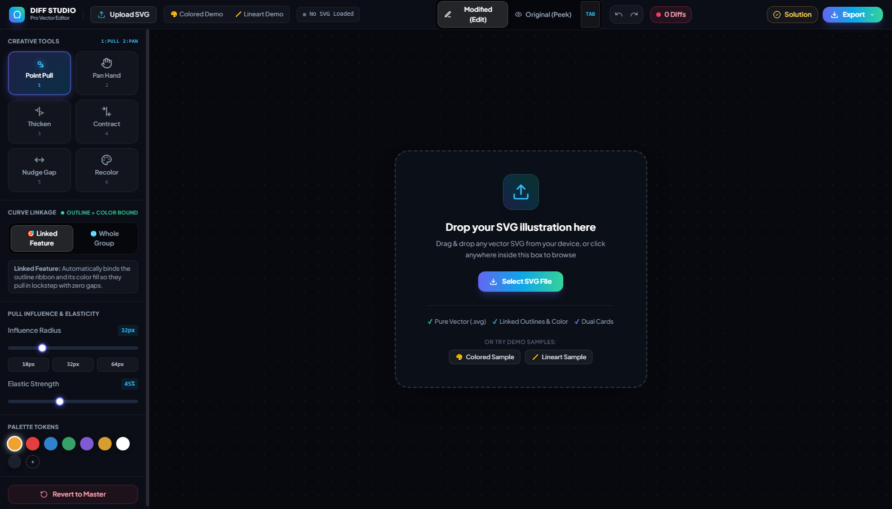

# 🎨 Vector Difference Studio • Spot the Difference Creator

An interactive, high-precision vector web application for creating subtle, organic **"Spot the Difference"** puzzles from any user-uploaded SVG illustration.



---

## 🌟 Key Features

* **Universal SVG Upload & Dropzone:** Drag and drop any vector illustration from your device. Automatically parses dimensions, viewBox, and coordinate hierarchies.
* **Point-Based Linked Pull (`Point Pull` • Key: `1`):** Drops an anchor pin on any contour and binds both the outline ribbon and underlying color fills, applying smooth Gaussian Bézier deformation with zero white gaps or tearing.
* **Complete Creative Toolkit:**
  * **Point Pull (1):** Organic elastic curve displacement.
  * **Pan Hand (2):** Silky trackpad and mouse panning.
  * **Thicken (3):** Expand line weight.
  * **Contract (4):** Shrink line weight.
  * **Nudge Gap (5):** Micro-spacing offsets.
  * **Recolor (6):** Palette-based fill swapping.
* **Segmented A/B Blink Comparison:** Hold <kbd>TAB</kbd> or press `O` to instantly peek at the original master artwork.
* **Circled Solution Generator:** Computes tight bounding boxes around all modified vector elements and renders numbered answer keys.
* **Multi-Format Export Menu:**
  * **Dual Puzzle Card:** Side-by-side challenge card (Original vs. Modified).
  * **Solution Card:** Side-by-side challenge card with numbered red answer circles.
  * **PNG / JPEG Images:** Scaled raster exports with custom quality sliders.
  * **SVG Vector File:** Pure lossless vector code containing all edits.
* **Agent-Controllable:** Built-in `window.editorAPI` and local bridge supporting external AI coding agents (Antigravity, Claude Code, Cursor).

---

## 🚀 Quick Start

### Run Locally:
```bash
# Clone the repository
git clone https://github.com/Mohitdhua/vector-difference-studio.git
cd vector-difference-studio

# Start any local HTTP server
python -m http.server 8080
# or
npx serve .
```
Open **`http://localhost:8080`** in your browser.

---

## ⌨️ Keyboard Shortcuts

| Shortcut | Action |
| :--- | :--- |
| `1` | Point Pull Tool |
| `2` or `H` | Pan Hand |
| `3` | Thicken Tool |
| `4` | Contract Tool |
| `5` | Nudge Gap Tool |
| `6` | Recolor Tool |
| `TAB` (Hold) | Blink to Original Baseline |
| `O` | Toggle A/B View |
| `0` or `F` | Auto-Fit to Screen |
| `Ctrl + Z` | Undo |
| `Ctrl + Y` | Redo |
| `Right-Click Drag` | Pan Canvas |
| `Wheel / Pinch` | Smooth Zoom |

---

## 📄 License
MIT License • Created by [Mohitdhua](https://github.com/Mohitdhua)
